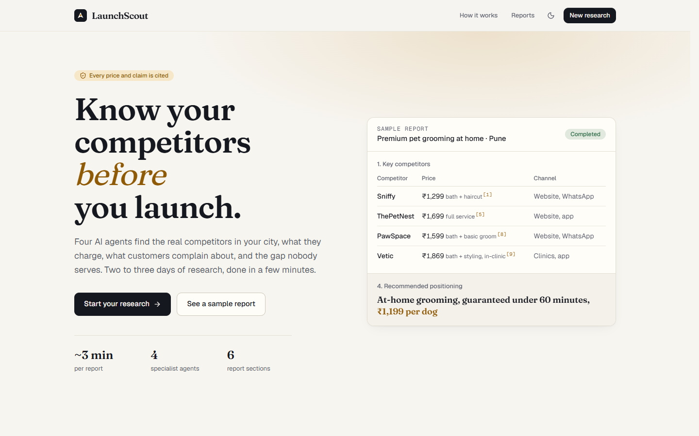
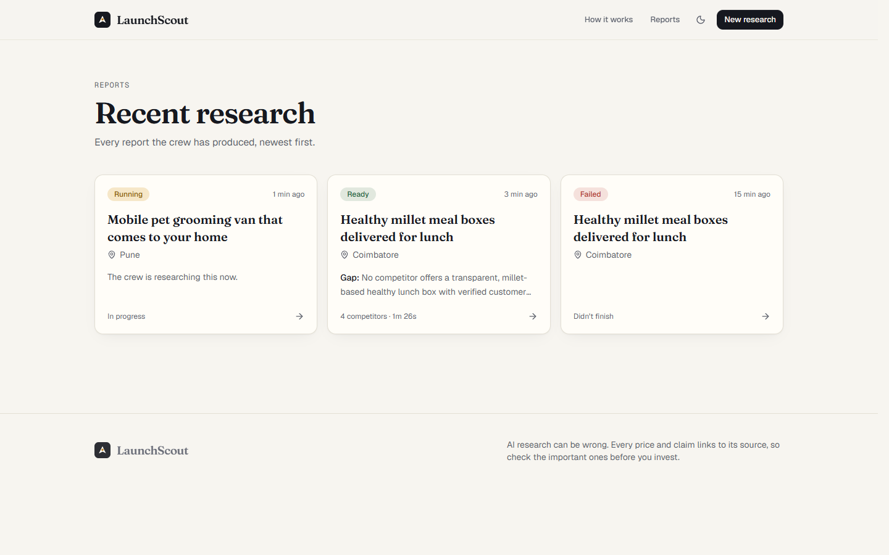
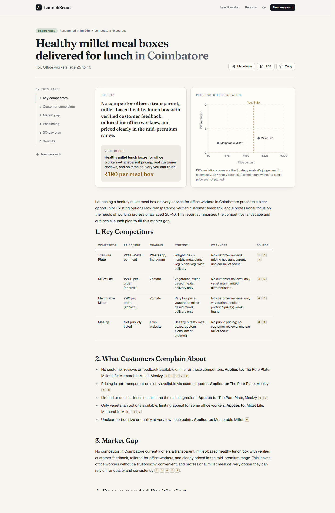
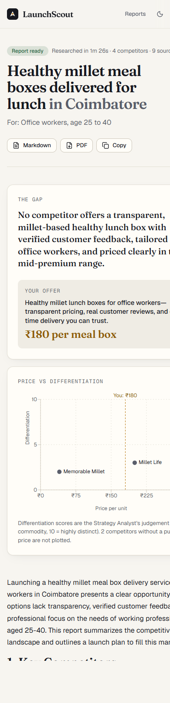
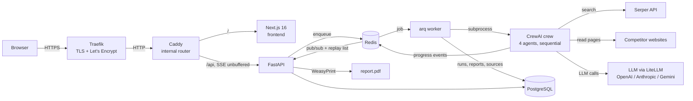

# LaunchScout

> A crew of four AI agents that researches the market for a new business idea and delivers a sourced competitor report (prices, customer complaints, the market gap, and a 30-day launch plan) in about two minutes.

**Live:** https://launchscout.sundajigenai.tech



## Overview

A founder types an idea, a city and a target customer, for example *"Healthy millet meal boxes delivered for lunch · Coimbatore · Office workers, age 25 to 40"*. Four CrewAI agents then work in sequence:

| # | Agent | Job | Tools |
|---|-------|-----|-------|
| 1 | Market Researcher | Find 3 to 5 real competitors in the city with price per unit, offers and sales channels | Serper search, website reader |
| 2 | Review Analyst | Find what customers like and complain about for each competitor | Serper search, website reader |
| 3 | Strategy Analyst | Comparison matrix, the single clearest market gap, recommended price and positioning | none (reasons over 1 and 2) |
| 4 | Report Writer | Founder-friendly report with a week-by-week 30-day plan and numbered sources | file writer (`report.md`) |

The report always has six sections: **Key Competitors** (table), **What Customers Complain About**, **Market Gap**, **Recommended Positioning**, **30-Day Launch Plan** and **Sources**. Every price and claim cites `[n]` back to a real URL. While the crew runs, the app streams which agent is working, which tool it is calling and what it found. Finished reports render in the app and download as Markdown or PDF.

**Data integrity.** Tasks 1 to 3 return Pydantic models, and every competitor carries `source_urls`. A guardrail on task 1 rejects fewer than 3 competitors, or any competitor without a price field and a source, and retries up to twice. If a price can't be found, the report says "Not publicly listed" and cites the page that was checked. After the run, a validator confirms all six headings exist and that every `[n]` maps to a source. If it fails, the run fails with a clear message.

| History | Report | Mobile |
|---|---|---|
|  |  |  |

## Architecture



- **Frontend** (`frontend/`): Next.js 16 App Router, TypeScript, Tailwind CSS v4, shadcn/ui, Recharts. Pages: landing `/`, new research `/scout`, live run and report `/runs/[id]`, history `/runs`.
- **API** (`backend/app/api`): `POST /api/runs`, `GET /api/runs/{id}`, `GET /api/runs/{id}/events` (Server-Sent Events), `GET /api/runs/{id}/report.md` and `.pdf`, `GET /api/runs`, `GET /api/health`. Interactive docs at `/api/docs`.
- **Worker** (`backend/app/worker`): arq on Redis. Each crew runs in a child process so a crash or timeout can't take the worker down. Events carry a `seq` number, are kept in a 24-hour Redis list for replay, and are published live, so the browser can reconnect without losing any.
- **Crew** (`backend/app/crew`): `config/agents.yaml` and `config/tasks.yaml`, wired with `@CrewBase` in `crew.py`.
- **Production**: Traefik (already on the server) terminates TLS. Caddy routes `/api` and the SSE stream (no buffering, no compression) and sends everything else to the frontend.

Design decisions and their reasons are logged in [`docs/DECISIONS.md`](docs/DECISIONS.md).

## Local setup

Requirements: Docker Desktop, plus an LLM key and a [Serper](https://serper.dev) key.

```bash
cp .env.example .env          # then fill in LLM_MODEL, its API key, and SERPER_API_KEY
docker compose up --build
```

- Frontend: http://localhost:3000
- API: http://localhost:8010/api/docs

### Run the crew from the command line (no database needed)

```bash
cd backend
python -m venv .venv && .venv/Scripts/activate      # macOS/Linux: source .venv/bin/activate
pip install -e ".[dev]"
python -m app.crew.run --idea "Healthy millet meal boxes delivered for lunch" \
    --city Coimbatore --customer "Office workers, age 25 to 40"
```

Progress prints live, and the report is written to `outputs/<run_id>/report.md`.

### Tests and checks

```bash
cd backend
pytest                 # unit tests with mocked LLM and Serper (live test excluded)
pytest -m live         # one real end-to-end run with the sample input (costs about $1)
ruff check . && ruff format --check . && mypy app

cd ../frontend
npm run typegen && npm run typecheck && npm run lint && npm run build
```

## Environment variables

Every variable is documented inline in [`.env.example`](.env.example). The ones you must set:

| Variable | Purpose |
|---|---|
| `LLM_MODEL` | Any LiteLLM model id, e.g. `openai/gpt-4.1`, `anthropic/claude-sonnet-5-5`, `gemini/gemini-2.5-pro` |
| `OPENAI_API_KEY` / `ANTHROPIC_API_KEY` / `GEMINI_API_KEY` | Only the one that matches `LLM_MODEL` |
| `SERPER_API_KEY` | Web search for agents 1 and 2 |
| `POSTGRES_PASSWORD` | Change it from the default in production |
| `DOMAIN`, `TRAEFIK_NETWORK`, `TRAEFIK_CERTRESOLVER`, `TRAEFIK_ENTRYPOINT` | Production only (see Deploy) |

Useful knobs: `LLM_MODEL_RESEARCH` (a cheaper model for agents 1 and 2), `SCRAPE_MAX_CHARS`, `AGENT_MAX_ITER`, `SEARCH_CACHE_TTL_SECONDS`, `DAILY_RUN_CAP` (all visitors, per UTC day, default 30), `REUSE_WINDOW_DAYS` (serve a recent identical report, default 7), `RATE_LIMIT_RUNS` (per IP, default `3/day`), `MAX_CONCURRENT_RUNS`, `RUN_TIMEOUT_SECONDS`, `TURNSTILE_ENABLED` (Cloudflare captcha on the form).

API keys stay on the server. The browser only ever sees `NEXT_PUBLIC_*` values, which are public by design.

## Deploy

Production runs on an Ubuntu VPS behind an existing Traefik (here, the one that ships with n8n).

**First time**

1. Point a DNS A record for your domain at the VPS. Only list hosts in the Traefik rule that have DNS: Let's Encrypt rejects the whole certificate if one name fails.
2. Find Traefik's settings on the server:
   ```bash
   docker inspect <traefik container> --format '{{range $k,$v := .NetworkSettings.Networks}}{{$k}} {{end}}'   # TRAEFIK_NETWORK
   docker inspect <traefik container> --format '{{join .Config.Cmd " "}}'   # certificatesresolvers.<NAME>, entrypoints.<NAME>
   ```
3. Run the bootstrap as root. It's idempotent: it creates a `deploy` user, installs Docker, sets up UFW (22/80/443), fail2ban, unattended upgrades and a nightly `pg_dump` backup (7-day retention), clones the repo, creates `.env` interactively and starts the stack:
   ```bash
   curl -fsSL https://raw.githubusercontent.com/<owner>/<repo>/main/deploy/bootstrap.sh -o bootstrap.sh
   sudo REPO_URL=https://github.com/<owner>/<repo>.git DOMAIN=launchscout.example.com \
        TRAEFIK_NETWORK=n8n_default TRAEFIK_CERTRESOLVER=mytlschallenge bash bootstrap.sh
   ```
4. In GitHub, set the secrets `VPS_HOST`, `VPS_USER` (`deploy`) and `VPS_SSH_KEY`, and the variables `DOMAIN` and `DEPLOY_ENABLED=true`. Set the key from the file so it isn't mangled: `gh secret set VPS_SSH_KEY < ~/.ssh/<deploy key>`.

**Updates.** Push to `main`. CI lints, type-checks, tests and builds both images. The Deploy workflow SSHes in as `deploy`, runs `git reset --hard origin/main` and `docker compose -f docker-compose.yml -f docker-compose.prod.yml up -d --build`, then polls `https://$DOMAIN/api/health`. You can also run it by hand from the Actions tab.

**Backups.** Nightly at 03:17 server time into `/home/deploy/backups`, kept 7 days. Restore:
```bash
gunzip -c launchscout-YYYYmmdd-HHMM.sql.gz | docker compose exec -T postgres psql -U launchscout launchscout
```

## Cost notes

Measured on the live site with `openai/gpt-4.1` (20 Nov 2026):

| Run | Time | Tokens | Searches | Approx. cost |
|---|---|---|---|---|
| Millet meal boxes · Coimbatore | 86 s | 417k | 11 | ~$0.85 LLM + ~$0.01 Serper |
| Mobile pet grooming · Pune | 95 s | 341k | 11 | ~$0.70 LLM + ~$0.01 Serper |

The tokens are almost all input: each agent re-sends what it has read on every step of its loop. To spend less, set `LLM_MODEL_RESEARCH` to a cheaper model for agents 1 and 2, or lower `SCRAPE_MAX_CHARS` or `AGENT_MAX_ITER`. Identical searches are cached in Redis for 24 hours, and a repeat request for the same idea, city, customer and known competitors within `REUSE_WINDOW_DAYS` (default 7) gets the existing report for free; the page says so and offers "Run fresh research". On the public site, `DAILY_RUN_CAP` (default 30 new runs per UTC day across all visitors, so roughly $25/day at most with GPT-4.1) is the hard ceiling on spend; `RATE_LIMIT_RUNS` (3 per visitor per day) and `MAX_CONCURRENT_RUNS` sit under it. Cost estimates use list prices at the time of writing; check your provider's current prices.

## Troubleshooting

| Symptom | Cause and fix |
|---|---|
| Browser warns about the certificate; it shows `TRAEFIK DEFAULT CERT` | Let's Encrypt failed. Run `docker logs <traefik> 2>&1 \| grep -i acme`. Most often a host in the router rule has no DNS record, or the cert resolver name is wrong. |
| Traefik's `404 page not found` | No router matches the host. Check `DOMAIN` in the server `.env`, and that Caddy joined `TRAEFIK_NETWORK` (`docker network inspect <network>`). |
| Run fails at once with `Could not resolve authentication method` | No API key for the `LLM_MODEL` provider in the **server's** `.env`. Add it, then `docker compose ... up -d backend worker`. |
| Deploy workflow: `Load key ... error in libcrypto` | The `VPS_SSH_KEY` secret is corrupted. Re-set it from the file: `gh secret set VPS_SSH_KEY < keyfile`. |
| Live progress stops updating | The page reconnects on its own and replays missed events. If it never resumes, check that the proxy isn't buffering `/api/runs/*/events`. |
| Few prices found for food businesses | Swiggy and Zomato menus are rendered by JavaScript and invisible to the page reader. The report says "Not publicly listed" and cites the page checked. |
| `git push` rejected for `.github/workflows/*` | Your `gh` token needs the workflow scope: `gh auth refresh -h github.com -s workflow`. |
| Local Lighthouse scores are erratic on Windows | Proxy auto-detection slows Chrome. Add `--chrome-flags="--no-proxy-server"`. |
